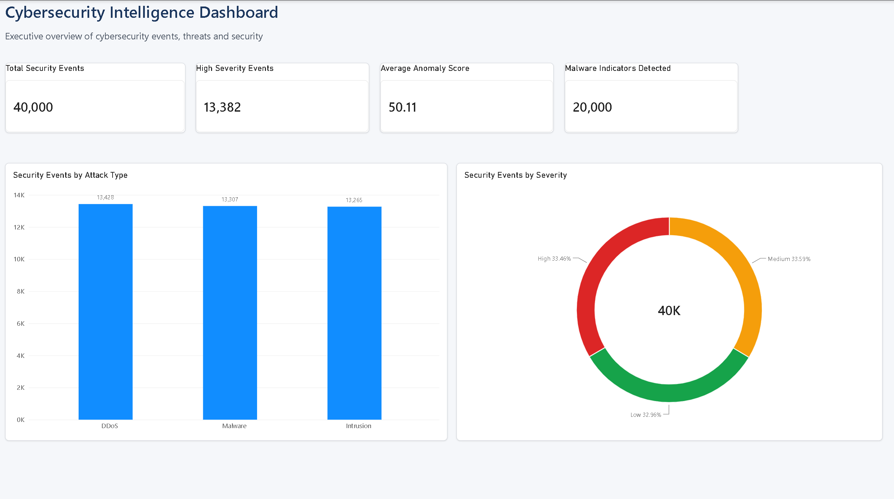
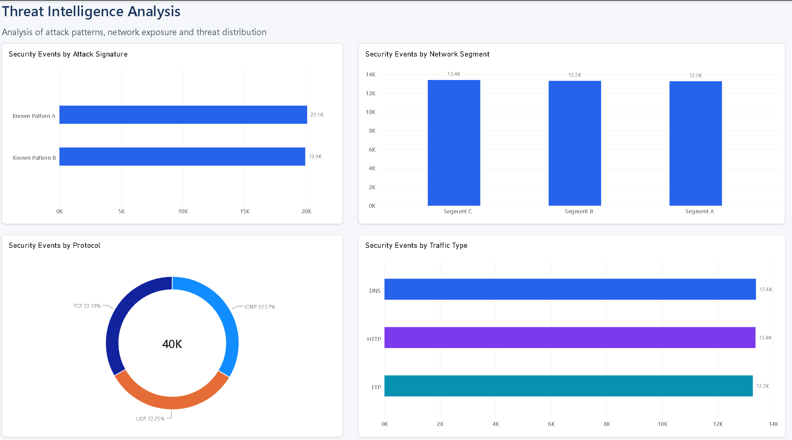
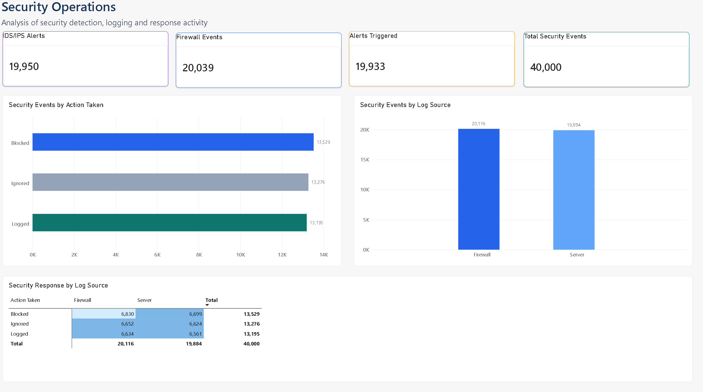

# Cybersecurity Intelligence Dashboard

Interactive Microsoft Power BI dashboard focused on cybersecurity events, threat intelligence, network exposure, and security operations.

The dashboard analyzes **40,000 cybersecurity event records** across three analytical pages, providing an executive overview, detailed threat intelligence, and operational security analysis.

---

## Project Status

**Complete**

The dashboard consists of three completed pages:

- Executive Security Overview
- Threat Intelligence Analysis
- Security Operations

---

## 1. Executive Security Overview

The Executive Security Overview provides a high-level view of cybersecurity activity, risk, and threat severity.

### Key Metrics

- **40,000** Total Security Events
- **13,382** High Severity Events
- **50.11** Average Anomaly Score
- **20,000** Malware Indicators Detected

### Key Analysis

- Security Events by Attack Type
- Security Events by Severity
- DDoS, Malware, and Intrusion Analysis
- High, Medium, and Low Severity Distribution

### Dashboard Preview

---

## 2. Threat Intelligence Analysis

The Threat Intelligence Analysis page provides a more detailed view of attack patterns, network exposure, protocol activity, and traffic characteristics.

### Key Analysis

- Attack Signature Analysis
- Network Segment Analysis
- Protocol Analysis
- Traffic Type Analysis

### Key Insights

- Known Pattern A accounts for approximately **20.1K security events**, compared with **19.9K** for Known Pattern B.
- Security events are distributed almost evenly across the three network segments, with approximately **13.3K to 13.4K events per segment**.
- Protocol activity is evenly distributed between **ICMP (33.57%)**, **UDP (33.25%)**, and **TCP (33.18%)**.
- DNS and HTTP each account for approximately **13.4K events**, while FTP accounts for approximately **13.3K events**.

### Dashboard Preview

---

## 3. Security Operations

The Security Operations page focuses on security detection, logging, and response activity.

### Key Metrics

- **19,950** IDS/IPS Alerts
- **20,039** Firewall Events
- **19,933** Alerts Triggered
- **40,000** Total Security Events

### Key Analysis

- Security Events by Action Taken
- Security Events by Log Source
- Security Response by Log Source

### Key Insights

- **13,529** security events were blocked.
- **13,276** security events were ignored.
- **13,195** security events were logged.
- Firewall was the log source for **20,116** events, compared with **19,884** events from the server log source.
- The Security Response by Log Source matrix combines response actions and log sources to provide a more detailed view of operational security activity.

### Dashboard Preview

---

## Technology Stack

- Microsoft Power BI
- Power Query
- DAX
- Cybersecurity Event Analytics
- Data Visualization
- Business Intelligence

---

## Data Source

Cyber Security Attacks dataset containing **40,000 cybersecurity event records**.

The dataset includes information related to attack characteristics, severity, network activity, protocols, traffic types, security alerts, and security operations.

---

## Project Objective

The objective of this project is to demonstrate how Microsoft Power BI can be used to analyze cybersecurity event data and present the results at different analytical levels.

The dashboard is structured around three areas:

1. **Executive Security Overview** - What is happening and how severe is it?
2. **Threat Intelligence Analysis** - Which attack patterns and network characteristics are present?
3. **Security Operations** - How are security events detected, logged, and handled?

---

## Dashboard Structure

| Dashboard Page | Focus | Status |
| --- | --- | --- |
| Executive Security Overview | Security activity and risk | Complete |
| Threat Intelligence Analysis | Attack and network patterns | Complete |
| Security Operations | Detection, logging, and response | Complete |

---

## Developed By

**ItDevOPS BV**

Business Intelligence | Data Analytics | Power BI Solutions
