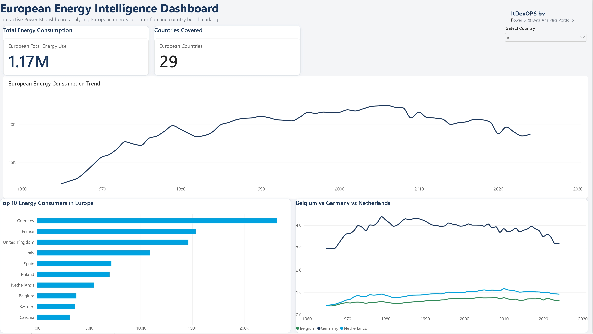

# European Energy Intelligence Dashboard

Interactive Power BI dashboard analysing European energy consumption trends and country benchmarking.

## Dashboard Preview

## Overview

This dashboard demonstrates Power BI reporting capabilities including:

- KPI reporting
- Trend analysis
- Country benchmarking
- Interactive filtering
- Top 10 country ranking

## Key Metrics

- Total Energy Consumption
- Countries Covered
- Energy Consumption Trends
- Country Comparison

## Technologies Used

- Power BI
- Power Query
- DAX

## Created By

**ItDevOPS BV**

Power BI & Data Analytics Portfolio
