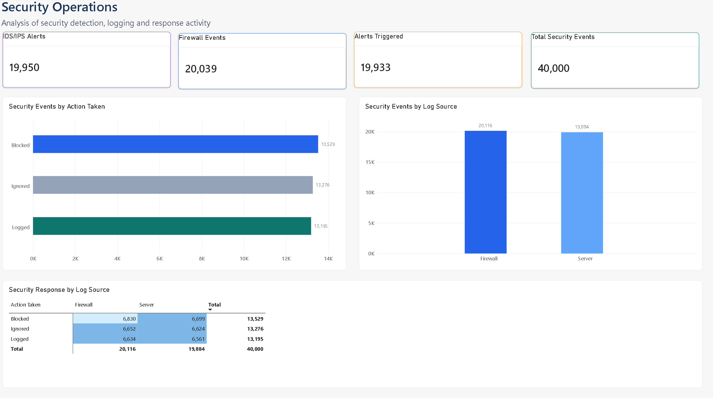
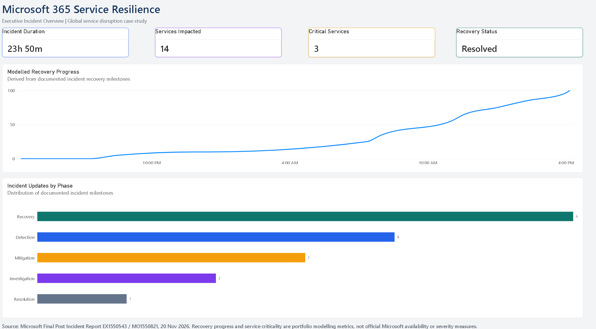

# ItDevOPS Power BI Portfolio

A portfolio of Business Intelligence and Data Analytics solutions developed by **ItDevOPS BV** using Microsoft Power BI.

The projects in this repository demonstrate practical experience with data preparation, data modeling, DAX, KPI reporting, interactive visualization, and analytical dashboard design across multiple business and technology domains.

---

## Available Dashboards

### 01 — European Energy Intelligence Dashboard

Power BI dashboard focused on European energy consumption, country benchmarking, trend analysis, and KPI reporting.

**Key capabilities:**
- Energy consumption analysis
- Country-level benchmarking
- Trend analysis
- KPI monitoring
- Power Query data transformation
- DAX-based analytical reporting

**Status:** Complete

[View European Energy Intelligence Dashboard](./European-Energy-Intelligence-Dashboard/)

---

### 02 — Belgian Public Transportation Intelligence Dashboard

Power BI dashboard focused on Belgian public transportation performance, operational analysis, and KPI monitoring.

**Key capabilities:**
- Public transportation analysis
- Operational KPI reporting
- Performance comparisons
- Interactive dashboard navigation
- Data preparation with Power Query
- DAX-based calculations

**Status:** Complete

[View Belgian Public Transportation Intelligence Dashboard](./Belgian-Public-Transportation-Intelligence-Dashboard/)

---

### 03 — Cybersecurity Intelligence Dashboard

Power BI dashboard analyzing **40,000 cybersecurity events** across executive security monitoring, threat intelligence, and security operations.

**Dashboard pages:**
1. Executive Security Overview
2. Threat Intelligence Analysis
3. Security Operations

**Key capabilities:**
- Security KPI monitoring
- Attack and severity analysis
- Threat intelligence analysis
- Network and protocol analysis
- IDS/IPS and firewall monitoring
- Security response analysis

**Status:** Complete

#### Dashboard Preview



[View Cybersecurity Intelligence Dashboard](./Cybersecurity-Intelligence-Dashboard/)

---

### 04 — Microsoft 365 Service Resilience Dashboard

Power BI incident intelligence dashboard focused on Microsoft 365 service disruption, incident recovery, service impact, and operational resilience.

The project uses a documented Microsoft 365 service disruption as a public case study to demonstrate a more advanced multi-table Power BI model and incident analytics approach.

**Dashboard progress:**
1. Executive Incident Overview — Complete
2. Service Impact Analysis — In Development
3. Incident Timeline & Root Cause — Planned
4. Business Continuity & Resilience — Planned

**Key capabilities:**
- Incident duration and recovery analysis
- Service impact modeling
- Relational Power BI data modeling
- Service criticality analysis
- Incident milestone classification
- Operational resilience reporting

**Status:** In Development

#### Current Dashboard Preview



[View Microsoft 365 Service Resilience Dashboard](./Microsoft-365-Service-Resilience-Dashboard/)

---

## Portfolio Overview

| Project | Domain | Key Focus | Status |
| --- | --- | --- | --- |
| European Energy Intelligence Dashboard | Energy | Consumption, trends and country benchmarking | Complete |
| Belgian Public Transportation Intelligence Dashboard | Transportation | Operational performance and KPI analysis | Complete |
| Cybersecurity Intelligence Dashboard | Cybersecurity | Threat intelligence, detection and security operations | Complete |
| Microsoft 365 Service Resilience Dashboard | IT Operations | Incident recovery, service impact and operational resilience | In Development |

---

## Core Capabilities

- Business Intelligence dashboard development
- Data preparation and transformation
- Relational data modeling
- DAX measures and calculated columns
- KPI design and executive reporting
- Interactive data visualization
- Trend and operational analysis
- Cybersecurity analytics
- Incident and service resilience analytics

---

## Technology Stack

- Microsoft Power BI
- Power Query
- DAX
- Data Modeling
- Data Visualization
- Business Intelligence
- Data Analytics
- GitHub

---

## Repository Structure

```text
itdevops-powerbi-portfolio/
│
├── European-Energy-Intelligence-Dashboard/
├── Belgian-Public-Transportation-Intelligence-Dashboard/
├── Cybersecurity-Intelligence-Dashboard/
├── Microsoft-365-Service-Resilience-Dashboard/
│
└── README.md
